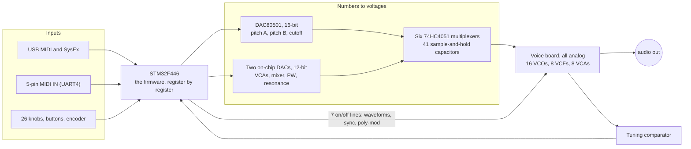
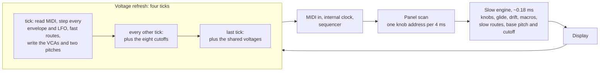
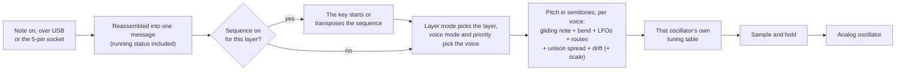
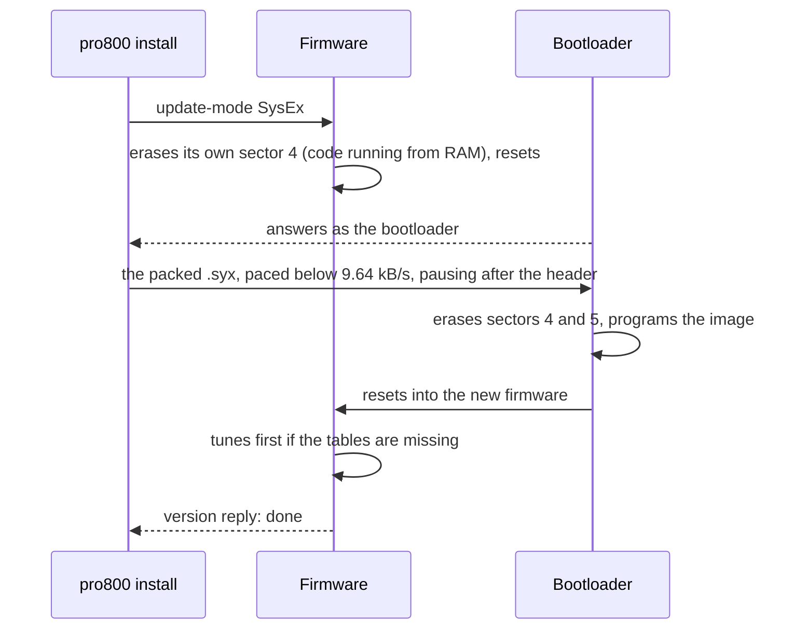

# PRO-8000

PRO-8000 is an alternative firmware for the Behringer PRO-800 (STM32F446), flashed through the synth's own
bootloader. Written from scratch for this hardware, with GliGli's p600fw (Prophet-600 firmware) as the reference for
how the analog side behaves. It's an independent project, not affiliated with Behringer or Music Tribe.

It exists because Music Tribe, Behringer's parent company, published
[PRO800-Firmware-Packer](https://github.com/MusicTribeOpenSource/PRO800-Firmware-Packer): the main-board
[schematic](https://github.com/MusicTribeOpenSource/PRO800-Firmware-Packer/blob/main/Schematics/PRO800_Main_Schematics.pdf), the
chip's memory layout, and the packer that turns a firmware image into an update the bootloader accepts.

> [!WARNING]
> **Wildly experimental.** A hobby project, built and tested on a single synth. It replaces the PRO-800's firmware,
> drives its analog circuits directly and rewrites its patch memory. Use it entirely at your own risk: it comes as
> is, without warranty of any kind (see [LICENSE](LICENSE)), and the authors accept no liability if it harms your
> synth, your patches or anything connected to it. Flashing unofficial firmware may also void the synth's warranty.
> Back up your patches first, and know the way back: hold 0 and 7 at power-up to reach the bootloader and flash the
> stock firmware.

**Online** (GitHub Pages):

- [How the firmware works](https://klaine.github.io/pro-8000/how-it-works.html): a guided tour with diagrams, from the
  circuit board up.
- [New territory for sound design](https://klaine.github.io/pro-8000/sound-design.html): what the engine lets you do that
  the stock PRO-800 can't, with interactive figures and recipes.
- [The WebMIDI editor](https://klaine.github.io/pro-8000/editor/): every control, the mod matrix, patches and the
  sequencer from the browser (Chrome or Edge, with the synth on USB), and sounds in and out as JSON.

The user manual is [MANUAL.md](MANUAL.md).

**Features**

- **Bitimbral:** two layers (split, stack, or by MIDI channel), selected with Seq 1 / Seq 2, with knob pickup.
  Or one sound with a voice per MIDI channel: eight mono channels, or MPE with per-note bend, pressure and CC 74.
- **LFOs:** two per layer, with eight shapes (triangle, square, ramps, sine, sample & hold, drift, and a 1-16 step
  pattern for trance gates, edited on the web page).
  - Sync to MIDI clock in 15 divisions; a delay and fade-in per LFO, per voice.
  - Retrigger free, on the first key, on every key, or per voice (poly LFOs).
- **Envelopes:** four per voice, ADSR or DAHDSR (a delay and a hold), with analog, linear or swell curves and
  times shown in ms / s on the display. Env 3 and Env 4 are edited with the filter and amp ADSR knobs while Shift
  (Sync Source) is held.
  - Each one starts on key down or key up, and can cycle (attack, hold, fall, rest) endlessly or for 1-99 cycles.
  - Stage times in seconds, or in note values (1/32 to 8 bars) at the clock's tempo.
- **Shift:** a second layer on the knobs (LFO delay and fade, drift, detune, bend range, macro offsets, CC
  numbers, the MIDI channel) and buttons (compare, undo, quick save, layer copy, settings pages, panic).
- **Mod matrix:** 16 routes per layer, assigned from the panel in three steps (source, destination, depth: MOD
  ASSIGN on Arp Assign) and browsed by number, with two macros that are destinations and sources at once.
  - 27 sources: LFOs (either side of the middle, or 0 to 1), envelopes, velocity, mod wheel, aftertouch, pitch
    bend, pedal, two assignable CCs, CC 74 (timbre), gate, random, note, voice number, a fixed 1, the sequencer's
    four lanes and the macros.
  - 46 destinations: pitch, cutoff, the VCA, mixer and pulse widths, every envelope stage, glide, detune, volume,
    the LFOs' amounts, rates and routings, morph and the macros.
- **Autotune:** within about a cent across C1-C8. The tables are stored in the EEPROM.
- **Sequencer:** a step sequence per patch, played from a key and transposed by it (up to 64 steps, gate, ties,
  swing, clock sync), with up to four automation lanes as mod sources; edited on the web page.
- **Expression and play:** per-voice poly aftertouch, mono / legato / poly per layer with note priority, a sustain
  pedal, a MIDI CC for every knob, program change, analog-style drift, scale quantize, and patch morph (any mod
  source fades every knob towards another patch). The sequencer has probability, ratchets and an arpeggiator.
- **Patches:** 128 with names, each with its own sequence, and the stock factory bank kept and importable. An empty
  slot starts from the init sound. A 66-sound bank for slots 1-66 is in `presets/`, built to show the engine off,
  installed in one click from the editor (or `presets/install.sh`); the editor loads and saves the same JSON.
- **MIDI:** USB MIDI (also firmware updates without touching the panel) and the 5-pin MIDI IN socket for notes,
  controllers and clock, on every channel or one. Or an internal clock with tap tempo, or the SYNC IN jack; the Sync Clock LED shows the beat.
- **A browser editor (WebMIDI):** sound, mod matrix, patches, factory bank, backup, tuning, plus a keyboard and a
  MIDI router.

Read **[MANUAL.md](MANUAL.md)** for how to use it, and [NOTES.md](NOTES.md) for the hardware research,
measurements and backlog.

## How it works

The short version of the [How the firmware works](https://klaine.github.io/pro-8000/how-it-works.html) guide, which
has the interactive figures.

### A digital brain for analog voices

Nothing digital touches the audio. Sixteen oscillators, eight filters and eight amplifiers on the voice board make the
sound; they're analog circuits steered by control voltages. The firmware's whole job is to decide those voltages and
keep setting them, hundreds of times a second. Vibrato isn't a wobbling sound the firmware makes: it nudges an
oscillator's voltage up and down and the analog oscillator wobbles by itself. The only thing it hears back is a tuning
signal.



Everything the firmware knows about the board came from Behringer's main-board schematic and from measuring the synth:
the voice board's circuit isn't published, so how many DAC steps make an octave, or where the amplifiers start to
open, was measured with test firmware and recordings.

### Three DACs, forty-one voltages

There are three DACs and 41 places that need a voltage, so every destination has its own 10 nF capacitor behind a
multiplexer, followed by a buffer the voice board reads. To set one voltage the firmware puts the value on a DAC (for
the DAC80501 that's 24 bits clocked out by hand, exactly 48 µs, each bit timed from the cycle counter), picks the
capacitor with three address lines, connects it and leaves it connected until the value is about to change, so the
capacitor settles while the next frame is already being clocked out. The three DACs feed different multiplexers, so
while a pitch or cutoff samples at a voice's address, that voice's VCA samples at the same address for free.

| Multiplexer | Fed by | Holds |
|---|---|---|
| U25, U32 | DAC80501 (16-bit) | Oscillator A and B pitch, voices 1-8 |
| U43 | DAC80501 | Filter cutoff, voices 1-8 |
| U24 | On-chip DAC 2 (12-bit) | VCA level, voices 1-8 |
| U23 | On-chip DAC 1 (12-bit) | Poly-mod amount, osc A and B level, noise, master volume, external filter |
| U15 | On-chip DAC 1 | Pulse width A and B, resonance |

Capacitors leak, so the firmware can never stop: it visits every capacitor again and again, forever.

### One loop, no operating system

The firmware is one loop that runs forever. Each trip around it is a pass, about 2.4 ms with eight voices sounding and
shorter with fewer, and the only interrupts are the 1 ms clock, USB and the MIDI IN serial port (both timestamp each
MIDI clock tick the moment it arrives) and the tuning comparator's edges while tuning. Nothing else touches the voices,
so no voice can change halfway through being worked out.



Why split the refresh? If envelopes only moved once per pass, a snappy attack would be a staircase of 2.4 ms steps. So
every envelope and LFO advances four times per pass, and the routes from them into pitch, cutoff and volume are applied
in the ticks too:

| Voltage | Written | Every (8 voices) | (1 voice) |
|---|---|---|---|
| VCA (each voice's volume) | at every tick | 0.6 ms | 0.3 ms |
| Filter cutoff | every other tick | 1.2 ms | 0.6 ms |
| Pitch A and B | two voices per tick | 2.4 ms | 1.2 ms |
| Shared CVs (mixer, PW, resonance) | once per pass | 2.4 ms | 1.2 ms |

Silent voices only need their capacitors topped up, so one of them is refreshed per pass, in turn. MIDI is read
before every tick, so a note starts within a tick of its message, and a voice's pitch is written before its VCA opens,
so you never hear a blip of the previous note.

### From a key press to a voltage



Every ingredient is in semitones, so combining them is plain addition; the slow parts are summed once a pass and the
envelope and LFO parts in every tick. Filter cutoff works the same way, with the filter envelope on the fast path and
the filter's own table at the end. Because the filters are measured like the oscillators, cutoff can follow the
keyboard exactly and a self-oscillating filter plays in tune.

### Autotune

No two analog oscillators are alike: untuned, this synth's sixteen spread from 77 cents flat to 63 cents sharp at the
same voltage. So the firmware measures each one. For every oscillator in turn it opens only that voice's VCA with a
sawtooth on just that oscillator, sets its CV to each of 14 points (0x2000, 0x3000 … 0xF000), timestamps every
falling edge from the comparator with the 168 MHz cycle counter (about 6 ns), and takes the median interval as the
period, which ignores stray edges. The filters are measured the same way, self-oscillating at full resonance. The
result is a table of measured pitches per oscillator and per filter, interpolated between points, kept in the EEPROM
so it survives updates. After tuning every oscillator is within ±0.7 cents from C1 to C8. The tuning signal is taken
before the master volume, so tuning is silent.

### Inside the engine

- **Layers and shared wires.** Two complete sets of per-voice settings: layer 1 plays voices 1-4 and layer 2 voices
  5-8 (all eight when layers are off; a mono layer takes one voice and leaves seven). Pulse width, resonance, the
  mixer and the waveform switches are single wires for all eight voices, so they're shared, and a route to one of
  them follows the layer's most recently played voice. The layer modes (off, split, stack, channel, 8CH, MPE) only
  change how notes are handed out.
- **Envelopes with an analog shape.** Four per voice. The analog attack charges towards 1.5 and stops at 1, so it
  shoots up and eases into the top; decay and release fall exponentially and are measured to -60 dB, so 2 s of
  release really is gone at 2 s. Linear and swell curves are alternatives. Each time knob follows
  `t = min + (max - min) * (2^(12k) - 1) / 4095`, which puts the useful short times in the lower half of the knob.
  The VCAs stay silent until about 7-9 % of their range, so the envelope is mapped onto 7 %-full and a silent voice
  gets exactly zero.
- **LFOs that follow a clock.** MIDI clock ticks jitter, so the interrupts timestamp each tick, the firmware averages
  the interval for the tempo, and between ticks it interpolates the phase: smooth, and still landing on the beat. In
  per-voice mode every voice keeps its own phase from its own note-on; each LFO has a delay and a fade-in per voice.
- **The mod matrix.** 16 routes per layer, each a source (of 27), a destination (of 46) and a depth from -99 to +99.
  For every voice the engine adds source × depth to the destination, in every tick for the envelope and LFO sources
  and once a pass for the rest. Pitch depths are squared (10 is a quarter semitone, 99 two octaves), VCA routes
  multiply the amp envelope so nothing opens a silent voice, routes into envelope stages and glide scale the time up
  to 16× either way, the macros are a source and a destination at once, and morph fades every knob of the layer
  towards a second patch before the engine reads the knobs at all.

### The panel

24 of the 26 knobs sit behind three 8-way multiplexers with 100 nF at the input, which needs about 4 ms to settle
after a change of address. The scan steps to the next address every 4 ms between passes and reads all three
multiplexers at once, so every knob is read every 32 ms, with a small dead band against jitter. Because two layers,
two LFOs and four envelopes share the same knobs, a knob whose job changes goes into pickup: the sound keeps the stored
value until the knob reaches it (a dot after the number on the display until then). Shift is the Sync Source button,
held or double-pressed to latch; under it the ADSR knobs edit Env 3 and Env 4, every other knob nudges a secondary
value by how far it moves, and the buttons get second jobs. The display shows real units: 737 Hz of cutoff, 1.25 s of
attack, -12 semitones, or a clock division.

### Where things are stored

| Memory | Holds |
|---|---|
| Flash, sectors 0-3 | The bootloader, write-protected and never touched |
| Flash from `0x08010000`, 128 kB (sector 4 and half of 5) | The firmware, about 72 kB in 0.9.1; the bootloader erases sectors 4 and 5 on every update |
| EEPROM `0x00000`-`0x17FFF` | 128 patches, 768 bytes each: both layers' knobs and settings, 32 mod routes, a name and the step sequence with its own checksum |
| EEPROM, after the patches | The stock factory bank, exactly where the stock firmware left it (importable); the global block (CC numbers, clock source and tempo); the tuning tables |

A full image of the EEPROM was saved before this firmware first wrote to it: writing it back is the way home to stock.

### MIDI in: USB, SysEx and the 5-pin socket

The USB driver is written for the chip's USB hardware and appears as a class-compliant MIDI device with Behringer's
IDs and name, so a computer treats it as the device it knows. Everything beyond notes and controllers travels as SysEx
after Behringer's header `F0 00 20 32 00 01 24 00`: read or set any parameter, list, load, save and rename patches,
dump and restore the EEPROM, tune, probe. The 5-pin socket's opto-isolator feeds UART4 at 31,250 baud, interrupting
on every byte: clock ticks go straight to the clock, timestamped like USB's, and everything else becomes the same
packets USB delivers. The USB socket is a device port; the synth can't host a USB keyboard.

### Updating safely



The bootloader sits at the start of the flash, write-protected; nothing here ever touches it, so holding buttons 0 and
7 at power-up always gets you back to it, with this firmware or the stock one.

### At power-on

1. Disconnect every sample-and-hold, so no capacitor samples garbage.
2. Clocks: the 8 MHz crystal up to 168 MHz, with the 48 MHz USB needs.
3. The 1 ms tick and the tuning timer; master volume to zero; EEPROM, panel and patch store.
4. The patch store (formatted first if it's in an older layout) and the tuning tables; the engine starts.
5. Every capacitor charged: the whole refresh runs 20 times.
6. The power LED and the version on the display.
7. No tuning tables? Tune now, silently, showing `tUnE`.
8. The last patch, the clock source and tempo, after one full knob scan so pickup starts from the real positions.
9. MIDI IN and USB start, and the loop runs forever, feeding the watchdog on every pass.

### What firmware can't change

| Can't | Because | Instead |
|---|---|---|
| A waveform, pulse width or resonance per voice or layer | One wire or switch for all eight voices | Pitch, cutoff and volume are per voice; a route to a shared control follows the last-played voice |
| Mix two waveforms of one oscillator at different levels | The waveform buttons are on/off lines | Put the second waveform on the other oscillator and use its level |
| Host a USB keyboard | The socket is a device port, and the chip runs USB in device mode | The 5-pin MIDI IN, or a computer or USB host box in between |
| Separate outputs per layer | The voice board sums everything to one mono signal | Per-layer volume with the VCAs |
| Digital FM or effects | The firmware never sees the audio; voltages update every 0.3-2.4 ms | The analog poly-mod path |

## Build

Needs zig (as the C cross-compiler), Music Tribe's packer cloned into `reference/PRO800-Firmware-Packer/` from
[its repository](https://github.com/MusicTribeOpenSource/PRO800-Firmware-Packer), and Xcode's swiftc for the tool.

```bash
scripts/build.sh
```

```bash
scripts/tools.sh
```

```bash
scripts/web.sh
```

`scripts/build.sh` writes `build/pro800-<VERSION>.syx`. `scripts/tools.sh` writes `build/pro800`, the macOS USB
MIDI tool. `scripts/web.sh` serves the editor at http://localhost:8800 (Chrome or Edge).

## Install

```bash
build/pro800 install build/pro800-0.9.1.syx --yes
```

Recovery is always possible through the bootloader: hold buttons 0 and 7 at power-up and flash any firmware `.syx`
(this one or the stock one, with SynthTribe). See the manual for going back to stock.

## Layout

| Path | Contents |
|---|---|
| `src/` | The firmware: drivers (DAC, S&H, panel, controls, EEPROM, USB MIDI, 5-pin MIDI in, tuning comparator), the engine (`synth.c`, `lfo.c`, `mod.h`), patch storage (`store.c`) and `main.c` (panel UI, SysEx). |
| `tools/pro800.swift` | The command-line tool (CoreMIDI). |
| `tools/web/` | The WebMIDI editor (one HTML file) and the panel map. |
| `docs/` | The guides on the GitHub Pages site; `scripts/pages.sh` builds them, with the editor, onto the `pages` branch. |
| `reference/`, `backup/` | Third-party material and the synth's own backups, not in git. |

## Licence

MIT, see `LICENSE`. GliGli's p600fw (GPL v3) served as a reference for the analog side's behaviour; none of its code is
in this firmware, which is written from scratch for the STM32F446. Music Tribe's packer and the schematic in
`reference/` are third-party and stay out of the repository.
